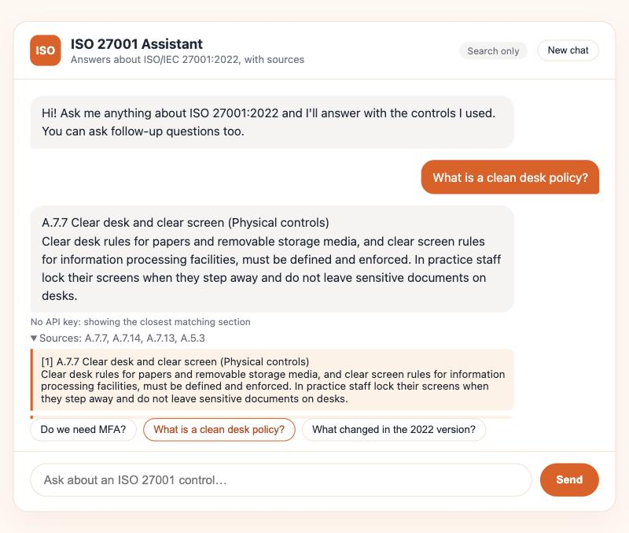

# ISO 27001 Assistant

A chatbot that answers questions about **ISO/IEC 27001:2022** using **Retrieval-Augmented Generation (RAG)**. It finds the relevant Annex A controls in a local vector database, then **Claude** writes a short answer from those controls only, with numbered citations you can expand to check. Answers stream in as they are written, and you can ask follow-up questions.



*Shown in search-only mode (no API key), where the app answers with the best-matching control. With a key, Claude writes the answer and cites the sources as [1], [2].*

Built with **FastAPI**, **ChromaDB**, **SentenceTransformers** (`all-MiniLM-L6-v2`), the **Claude API** and a plain HTML/CSS/JavaScript chat page.

## Features

- Answers grounded in the retrieved controls, with `[n]` citations and expandable sources
- **Streaming**: the answer appears word by word (Server-Sent Events)
- **Follow-up questions**: "Do we need MFA?" then "what about for remote workers?" works, because recent turns are used for both retrieval and the answer
- Off-topic questions are refused without calling Claude
- Works without an API key (search-only mode), and falls back to search if the Claude call fails
- **Measured retrieval accuracy** with a test set (see [Evaluation](#evaluation))

## How it works

```
Build once:  data/iso27001.txt ─► one chunk per control ─► embed (MiniLM) ─► ChromaDB

Each message:
  message (+ previous question) ─► embed ─► nearest controls ─► drop if cosine distance > 0.80
                                                   │
                     ┌─────────────────────────────┴──────────────────────┐
               nothing left                                         numbered sources
                     │                                                    │
       "not covered by this guide"         Claude (recent turns + sources) streams a cited answer
                                                                          │
                                                   sources + answer ─► chat page
```

- **Dataset**: all 93 Annex A controls of ISO 27001:2022 in four themes (Organizational A.5, People A.6, Physical A.7, Technological A.8), plus ISMS clauses 4–10, the Statement of Applicability and what changed from the 2013 version. The descriptions are plain-language summaries written for this project, not the official text.
- **Chunking**: one chunk per control, stored with its control number (e.g. `A.7.7`) as metadata.
- **Follow-ups**: retrieval runs twice, once on the new message and once on the previous question plus the new message, and the results are merged. Claude also receives the last three question/answer pairs.
- **Grounding**: Claude is instructed to answer only from the retrieved sources, cite each claim and say when the guide doesn't cover a question, instead of guessing.

## Evaluation

`eval/questions.json` holds 33 test questions written the way users ask them (not copied from control titles): 28 ISO questions, each with the control(s) that count as correct, and 5 off-topic questions that should retrieve nothing.

```bash
python -m eval.evaluate
```

Results at the default settings (top 4 results, cutoff 0.80):

| Metric | Result |
|---|---|
| Top result is a correct control (hit@1) | **96.4%** (27/28) |
| A correct control is in the top 4 (hit@4) | **100%** (28/28) |
| Mean reciprocal rank | 0.982 |
| Off-topic questions rejected | **5/5** |

The one miss: "Do we need CCTV in the office?" ranks remote working (A.6.7) first and physical security monitoring (A.7.4) second, because "office" pulls toward the remote-working text.

The script also sweeps the distance cutoff, which is how `0.80` was chosen: at 0.75 one ISO question loses its correct control, and at 0.90 an off-topic question gets through.

| Cutoff | hit@4 | Off-topic rejected |
|---|---|---|
| 0.70 | 96.4% | 5/5 |
| 0.75 | 96.4% | 5/5 |
| **0.80** | **100%** | **5/5** |
| 0.85 | 100% | 5/5 |
| 0.90 | 100% | 4/5 |

Caveat: the test set was written by the author of the dataset, so these numbers are likely optimistic; questions from real users would be a stronger test.

## Project structure

```
ISO27001-Assistant/
├── backend/
│   ├── main.py         # FastAPI app: chat (streaming), ask, health; serves the chat page
│   ├── retrieval.py    # Semantic search, shared by the API and the evaluation
│   └── rag_setup.py    # Builds the ChromaDB vector store
├── eval/
│   ├── questions.json  # Test questions with expected controls
│   └── evaluate.py     # Reports hit@1, hit@k, MRR, off-topic rejection, cutoff sweep
├── frontend/
│   └── index.html      # Chat page
├── data/
│   └── iso27001.txt    # ISO 27001:2022 dataset
└── requirements.txt
```

## Setup

Requires Python 3.9+.

```bash
python3 -m venv venv
source venv/bin/activate
pip install -r requirements.txt
python -m backend.rag_setup
```

Set your Claude API key (from console.anthropic.com). Without it the app runs in search-only mode.

```bash
export ANTHROPIC_API_KEY=your-key-here
```

## Run

```bash
uvicorn backend.main:app --reload --port 8000
```

Open <http://127.0.0.1:8000>. The API docs are at <http://127.0.0.1:8000/docs>.

## API

`POST /api/chat` streams the answer as Server-Sent Events. Send the new message and the conversation so far:

```json
{
  "message": "what about for remote workers?",
  "history": [
    { "role": "user", "content": "Do we need MFA?" },
    { "role": "assistant", "content": "Yes, for critical systems and remote access [1]." }
  ]
}
```

Events, in order: `sources` (once, with `mode` and the retrieved controls), `delta` (pieces of the answer), and `done` (final `mode`).

`POST /api/ask` answers a single question with one JSON response (no history, no streaming):

```json
{ "question": "Do we need MFA?" }
```

`mode` is `claude`, `search-only` (no API key), `fallback` (Claude call failed) or `none` (nothing relevant found). `GET /api/health` reports the mode and the number of indexed chunks.

## Configuration

| Variable | Default | Purpose |
|---|---|---|
| `ANTHROPIC_API_KEY` | unset | Enables Claude answers |
| `CLAUDE_MODEL` | `claude-opus-5-5` | Model used to write answers |
| `MAX_DISTANCE` | `0.80` | Cosine distance cutoff for relevant chunks |

## Limitations and next steps

- The dataset summarises the 93 controls; it is not the full standard or the ISO 27002 guidance.
- The test set measures retrieval, not the quality of Claude's written answers; a next step is grading answers for faithfulness to their sources.
- Conversations live in the browser and are lost on reload.
